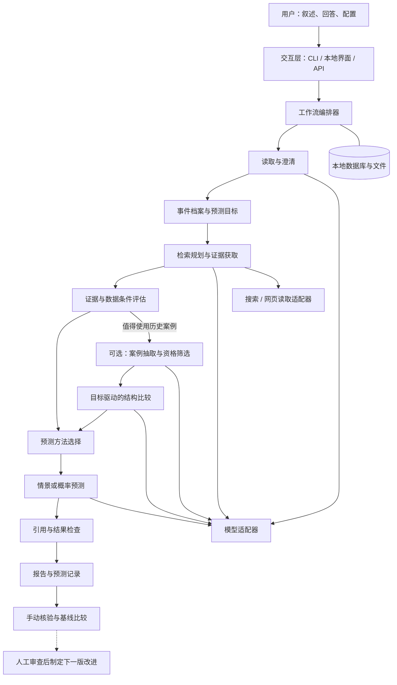

# 预测未来智能体：基础架构

版本：0.2（拟议架构）  
日期：2026-10-20  
状态：M1（T01–T05）、M2（T06–T08）及 M3-T09/T10 已实现并通过离线工具验收；2026-10-21 已记录真实模型读取、SearXNG 搜索及部分网页正文/证据链路验收，搜索存在上游波动，研究仍有部分完成情况，详见 [真实接入记录](10-M1-M2真实接入验收.md)。T11 实验封存、A/B/C 评分、真实预测效果、API 和界面尚未完成。实际契约及使用方式见 [README](../README.md) 和 [T10说明](12-T10冻结核验与恢复.md)。

T09 已实现情景优先、数值资格门禁、未校准主观预测草稿、共享模型预算及确定性报告；T10 冻结、修订、手动核验与步骤恢复已实现，见 [T10说明](12-T10冻结核验与恢复.md)；T11 评分尚未实现。当前状态及兼容规则见 [T09说明](11-T09情景与主观预测.md) 和 [T10说明](12-T10冻结核验与恢复.md)。

T08 的实际输入、人工相关性审查、未实现方法门禁、独立评估状态和迁移边界见 [T08说明](09-T08数据条件评估.md)。

项目动机见[设计理念](01-设计理念.md)，技术选型、数据字段与算法见[设计文档](03-设计文档.md)。

## 1. 架构目标

构建可本地运行的开源项目，允许使用者配置自己的模型、搜索服务和数据集。核心分析过程可以通过命令行、界面或API调用。

系统采用模块化单体：一个代码库、明确的领域对象与适配器接口。智能体是承担特定任务的调用角色，不要求独立进程，也不要求使用不同模型。

第一版采用确定步骤的工作流。程序控制状态、预算和依赖关系，模型在限定任务中生成结构化结果。

主线是证据驱动的判断预测与前瞻核验，不要求先收集训练集。历史案例分析为可选分支；统计拟合、校准和微调根据评估结果逐步引入。

## 2. 系统全景



核验与评估在第一版以手动登记结果和离线命令实现；周期监测与自动更新属于后续阶段。

## 3. 分层与依赖

| 层 | 责任 | 依赖限制 |
|---|---|---|
| 交互层 | 输入、澄清、进度、报告展示 | 调用应用服务，不直接操作模型 |
| 应用层 | 编排、状态转换、预算、取消与恢复 | 使用领域对象和接口 |
| 领域层 | 陈述、事件、证据、案例、预测与规则 | 不依赖Web框架或模型SDK |
| 基础设施层 | 模型、搜索、网页、存储、文件导出 | 实现应用层声明的接口 |

CLI和API复用同一套应用服务。本地界面通过API访问任务，不复制分析逻辑。

## 4. 核心模块

| 模块 | 输入 | 输出 | 责任边界 |
|---|---|---|---|
| Reader | 原始叙述 | 分层陈述、模糊项、当前未知 | 提取原意，不联网补写事实 |
| Clarifier | 模糊项、预测需求 | 澄清问题、用户修订 | 优先解决影响目标和检索的缺口 |
| EventBuilder | 修订后的分层结果 | 事件结构、预测问题 | 固定时间窗口与判定标准 |
| SearchPlanner | 事件结构、预测目标 | 多方向检索计划 | 优先当前状态与反证，按需查机制、案例和统计资料 |
| EvidenceCollector | 检索计划 | 网页、片段、来源元数据 | 搜索、抓取、日期检查、去重 |
| EvidenceAssessor | 事件、证据、可用数据 | 数据条件、缺口、可用方法及理由 | 检查时点、口径和来源，决定是否值得进入案例分支 |
| CaseExtractor（可选） | 证据集合 | 历史案例候选 | 分离事前状态与事后结果 |
| CaseSelector（可选） | 当前事件、候选案例 | 资格判定、比较结果 | 按预测目标比较，明确允许用途，不把相似度换成概率 |
| ForecastEngine | 事件、证据、数据条件 | 情景与概率记录 | 第一版支持情景和主观估计；数据方法按资格与实现能力启用 |
| ReportBuilder | 全部结构化产物 | 可读报告 | 解释已有结果，不创造新概率 |
| ResolutionService | 预测记录、结果证据 | 核验记录与评分 | 允许未决、争议、作废 |
| EvaluationService | 实验协议、各方法预测与核验记录 | 配对比较、覆盖率、误差和成本报告 | 第一版即提供；不根据测试结果自动修改正在评估的方法 |

模型可以承担Reader、SearchPlanner等任务；资格规则、数值计算和状态转换由程序执行。

## 5. 工作流与状态

```text
CREATED → READING → NEEDS_INPUT → STRUCTURED
                   └ 用户回答或明确保留未知 ┘
STRUCTURED → RESEARCHING → ASSESSING → FORECASTING → REPORTING → COMPLETED
                               └→ COMPARING → FORECASTING（可选）

执行阶段可进入 FAILED / CANCELLED。
缺少概率数据可以正常完成情景报告，不属于系统失败。
```

Reader发现目标、期限或判定标准缺失时进入NEEDS_INPUT。用户可以保留背景未知；预测目标仍未定义时，不生成正式数值预测，只返回目标建议。

用户在研究后修改目标时，生成新事件版本，作废相应下游缓存。旧预测保留。不能用新目标解释旧概率。

研究发现关键缺口时可进入NEEDS_INPUT，记录返回阶段；补充信息产生新事件版本，受影响步骤重新运行。案例分支跳过时记录原因，不标记失败。实验预测冻结后不得原位修改，更新另存且不混入首次预测评分。

## 6. 数据流与追溯关系

```text
AnalysisSession
  ├─ EventRevision
  │    ├─ Claims / Ambiguities / Unknowns
  │    └─ ForecastQuestion
  └─ AnalysisRun（绑定事件版本和方法版本）
       ├─ SearchPlan
       ├─ EvidenceDocument → EvidenceSpan
       ├─ EvidenceAssessment（数据条件、方法选择与跳过理由）
       ├─ HistoricalCase → Comparison（可选）
       └─ Forecast → ForecastOutcome
                    └─ Resolution

EvaluationProtocol（冻结项目名单、窗口、规则、方法与预算）
  └─ EvaluationEntry（项目、批次、实验组、预测ID或缺失原因）
       └─ EvaluationReport
```

每个结论通过证据ID指向来源片段。网页在多个地方被引用时仍是一个来源对象；多篇文章描述同一事件时，关联同一案例。

保存原始输入、规范化对象、检索参数、来源时间、提示词版本、模型标识、计算参数和运行成本。无需保存模型隐藏推理，保存可检查的理由和操作记录即可。

## 7. 方法选择与输出模式

选择器先检查证据条件，再检查方法是否已实现。第一版运行情景与主观模式，并提供实验用简单历史基线；通用参照数据估计与时间序列能力属于后续扩展，不因发现数据就声称已具备相应实现。

### 7.1 情景模式 `scenario_only`

证据不足或目标暂不能合理量化时，输出方向、条件、反证和观察信号，概率为空。

### 7.2 主观估计模式 `llm_judgment`

用户允许且目标明确时，由模型根据证据提出初始概率。始终标记为未校准；多个调用结果的平均不能自动视为统计置信度。

### 7.3 参照数据估计 `reference_class`（后续）

适用的数据集必须具有明确样本范围、相同结果定义、固定观察窗口和结果记录。执行程序化估计；是否经过校准另行记录。

方法选择器根据数据资格决定可用模式。即使用户要求数值，也不允许用不合格案例伪造数据估计；可以选择明确标注的主观估计，或返回无法估计的原因。

### 7.4 连续指标预测 `time_series`（后续）

存在连续、口径一致、时点可确认的指标数据时，先比较朴素基线与简单时间序列方法。预测区间或分布需要相应估计与检验；不能由一个点预测自动推导事件概率。

### 7.5 首个实验的历史基线 `release_frequency_baseline`

仅用于公开软件项目30天稳定版本发布实验。以预测时点前固定完整窗口的发布发生比例生成朴素概率，规则见设计文档第12节。它不依赖案例相似度，也不表示通用数据估计能力已经实现。未满足数据资格时记录缺失，不补成0或0.5。

## 8. 模型与搜索扩展点

模型接口：生成符合指定结构的对象、报告用量、声明结构化输出能力。第一版实现一种兼容API协议的适配器，随后按需要增加厂商适配器。

搜索接口：接收查询与时间限制，返回URL、标题、片段和日期线索。提供网络搜索、导入资料和离线演示三种入口。日期过滤需要抓取后复查，不能只相信搜索参数。

不同模型共用数据契约，但不保证共用提示词时效果相同。替换模型后应重新运行读取和预测评估。

领域扩展包可以定义问题模板、特征、结果枚举、参考数据和验证规则。核心流程不写死某个行业。

## 9. 执行与持久化

第一阶段使用CLI顺序执行，步骤完成即保存产物。进入NEEDS_INPUT时可以退出，后续命令继续。

提供界面时采用本地API服务和单独的单工作进程；任务表保存状态和步骤产物。长任务不只依赖HTTP请求内存。工作进程中断后标记待恢复，使用输入版本与步骤键避免重复提交。

对于外部调用超时且无法确认是否计费的情况，不声称严格执行一次。记录尝试次数并提示可能重复费用。

后续多用户部署再引入独立任务队列、集中数据库和身份体系。第一版默认监听本机地址，不以开发模式直接提供公共服务。

## 10. 失败与降级

| 情况 | 行为 |
|---|---|
| 模型输出格式错误 | 有限修复；仍失败则保留错误并停止该步骤 |
| 搜索不可用 | 接受用户导入资料，或生成明确标注的无检索分析 |
| 网页读取失败 | 保留候选线索，不作为已读取证据 |
| 无合格历史案例 | 正常跳过案例分支，使用情景或主观模式，不计算案例频率 |
| 来源互相冲突 | 并列记录争议及其对结论的影响 |
| 预算耗尽 | 停止新增调用，基于已有产物生成部分报告 |
| 结果不能核验 | 保持未决或标记作废，不强制填入0或1 |

## 11. 数据与外部访问边界

个人叙述默认保存在本地。调用外部模型意味着相关文本发送给用户配置的服务；界面首次使用时清楚说明数据流向。搜索查询尽量去除姓名、联系方式等不必要信息。

网页正文和上传资料都作为外部数据，不作为系统指令。模型提出的URL需经过程序检查再读取，防止网页内容诱导访问本机或内网资源。

凭据只由服务端适配器读取，不写入报告、提示词模板、普通日志或导出包。

## 12. 里程碑

| 阶段 | 可交付能力 | 验收重点 |
|---|---|---|
| M0 | 文档与契约 | 三份文档一致，明确第一版边界 |
| M1 | 读取、澄清、事件档案与实验协议 | 原文可追溯，未知保留，项目和判定规则可预登记 |
| M2 | 检索、证据、数据条件评估 | 正文引用可定位，日期与去重可检查，无案例也能继续 |
| M3 | 情景、主观预测、报告、冻结与手动核验、A/B/C基线比较 | 首个发布预测实验可运行，失败与未决不丢失 |
| M4 | 按实验诊断改进检索或可选数据方法 | 新版本在独立后续批次验证；案例拟合、校准、训练均非必做 |
| M5 | 本地界面与发布包 | 新用户按说明完成一次分析 |

M1至M3构成分析、记录和核验的首个闭环，评估不再推迟到取得训练集以后。首个实验为公开软件项目未来30天稳定版本发布预测；A为简单历史基线，B为同模型直接预测，C为完整证据流程。详见设计文档第12节。

M4按瓶颈选做，不阻塞M5；保存更多案例不触发自动训练，也不构成准确性提高的承诺。
