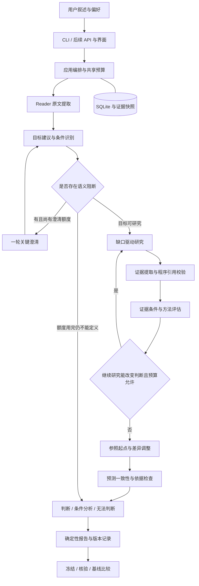

# 预测未来智能体：基础架构

版本：0.3（预测主线改造设计）
日期：2026-10-27
状态：M1、M2、M3-T09/T10/T11 与 M5 方案二 CLI 已有实现及离线工具验收；真实模型读取、搜索及部分正文链路见[接入记录](archive/10-M1-M2真实接入验收.md)。本版普通主线由 AssistanceService 复用原服务实现，自动构建目标、最多一轮澄清、有界研究和明确判断；旧人工模式及实验流程保留。真实预测效果、Web API 和界面未完成。

产品目标见[设计理念](01-设计理念.md)，规则见[详细设计](03-设计文档.md)，当前命令见[README](../README.md)。版本与改造边界见[决策记录](decisions/预测主线改造.md)。

## 1. 架构目标

保持模块化单体与显式工作流。交互入口调用共同应用服务；程序控制状态、资格、预算、时间和数值，模型承担限定的提取、问题建议、研究规划和判断任务。

普通模式由系统承担问题构建、证据摘录与相关性分析；用户负责表达目标、私人信息和纠正误解。高级模式保留逐项编辑和人工审查。内部审查不得统一依赖用户签名。

预测交付必须区别数值预测、方向/排序预测、条件分析、开放探索和无法判断；结束流程不意味着成功形成预测。

## 2. 系统全景



目标歧义可在研究前澄清；研究后可对关键私人事实使用剩余的同一轮额度。回答创建新事件版本并重新规划，已有研究与预算记录保留。开放探索在目标构建时明确分流。候选判断可在补充信息后修订，但不是无需时点检查的正式预测。程序停止循环规则见详细设计第5、6节。

## 3. 分层与依赖

| 层 | 职责 | 边界 |
|---|---|---|
| 交互层 | 叙述、进度、关键澄清、判断及来源展示 | 调用应用服务，不复制预测逻辑 |
| 应用层 | 目标构建、研究、提取、评估、预测编排 | 依赖领域对象及自身声明的端口 |
| 领域层 | 目标、条件、证据、判断、资格、时点与预算规则 | 不导入 HTTP、ORM、UI、模型 SDK 或应用服务 |
| 基础设施 | 模型、搜索、网页、SQLite、文件 | 实现端口，不决定业务资格 |
| 组合入口 | 构造与注入具体适配器 | 不承载另一套业务流程 |

当前 CLI 直接调用应用服务，后续 UI 经 API 调用同一服务。新职责可先作为现有模块内部用例实现，不预建框架、独立进程或空目录。

## 4. 核心模块

下表为职责划分；目标建议、澄清、证据提取由 AssistanceService 编排，判断检查复用领域验证器，并非每个职责都有独立类或模型调用。案例分支和通用统计方法仍未实现。

| 模块 | 输出 | 责任边界 |
|---|---|---|
| Reader | 原文档案、模糊与未知 | 不联网、不补事实、不把默认假设当原文 |
| EventBuilder / TargetBuilder | 可研究问题、窗口、结果及核验建议、行动条件 | 建议与用户要求分开，标明默认来源和必要澄清 |
| Clarifier | 有界问题及询问理由、答案/未知记录 | 程序去重、计数和停止；不按字段缺失机械追问 |
| SearchPlanner | 围绕参照、驱动、反证和缺口的查询 | 区分已知与待查，不固定套用两条英文查询 |
| EvidenceCollector | 候选、正文、来源和获取状态 | 复用抓取安全与快照，片段不冒充正文 |
| EvidenceExtractor | 候选精确引用、相关性、时点、冲突 | 模型辅助提取，程序校验偏移和归属；不宣称事实已核实 |
| EvidenceAssessor | 证据条件、未知影响、方法资格及理由 | 不用一条 current_state 引用或“存在未知”直接决定资格 |
| ForecastEngine | 参照、差异、主判断、备选、条件与更新信号 | 支持数字或排序；依据不足时条件分析/无法判断 |
| CaseExtractor / Selector（可选） | 合格参照与差异 | 不把相似度当概率，不能绕过样本资格 |
| JudgmentCheck | 定义、引用、概率和推断风险检查 | 硬约束由程序执行，语义检查不等于真实性证明 |
| ReportBuilder | 从已保存对象渲染报告 | 不新增事实、排名、主判断或概率 |
| Resolution / Evaluation | 核验、误差、覆盖、人工负担和成本 | 冻结与后续修订分开，不因拒绝而删除样本 |

## 5. 工作流与状态

以下是普通主线逻辑阶段；具体进度保存在 AssistanceState，基础 SessionStatus 继续负责执行锁：

```text
创建 → 原文读取 → 目标构建 → 研究 → 证据评估 → 判断 → 检查 → 交付
                  └ 必要澄清 ┘          └ 有界补充研究 ┘
```

NEEDS_INPUT 仅用于必须由用户回答且仍有额度的阻断，不用于所有未确认字段。默认整个普通会话最多一轮、最多三个问题；完成或跳过均消费机会，恢复和补充不重置。目标关键歧义可以在可用计划存在时触发澄清；研究后可询问关键私人事实。语义必要性与同义识别由模型负责，程序强制总量上限。无法定义目标时交付具体限制，不强行确认目标或预测。

交付状态与交付类型分开：成功保存条件分析可以是执行完成，但不能标为已形成方向或数值预测。模型/网络故障是执行问题，不得伪装成世界不可预测。预算耗尽时仅交付已有有效产物，否则保存未完成原因。

目标含义、结果规则或行动条件变化生成新目标版本；新增证据或假设修订保存新分析输入和判断，不改写旧记录。实现前明确哪些变更需要失效哪些步骤，避免无关补充迫使全部重做。

## 6. 数据流与追溯关系

```text
AnalysisSession → SourceText / EventRevision
                → QuestionProposal / 明示假设 / ClarificationLedger
                → 目标与结果定义 / 行动条件
                → AnalysisRun（模式、预算、版本）
                   → ResearchPlan / ResearchRun
                   → EvidenceDocument → EvidenceSpan → 相关性与语义审查
                   → EvidenceAssessment / ReferenceBasis
                   → EvidenceSnapshot（固定截止）
                   → ForecastJudgment → Report
                   → FrozenForecast → Resolution
EvaluationProtocol → 全部预登记条目 → 版本化产物 / 缺失原因 → EvaluationReport
```

实际契约使用 AnalysisPlan、AssistanceState、NumericBasis 和 JudgmentSummary；图中其余名称表示逻辑职责，不意味着存在同名实现。每条默认假设、参照、调整和观察信号保存其证据或推断性质；语义审查记录人工/模型/规则来源，不把模型审查标成人工确认。

## 7. 方法选择与输出模式

方法与交付类型分别建模。`scenario_only`、`llm_judgment` 等现有方法名保留兼容含义，不把旧情景数据重新解释成新排序预测。

| 条件 | 目标交付 |
|---|---|
| 有可解释判断依据，数值估计成立 | 未校准主观概率及主判断；无需逐次额外申请数字 |
| 数字无依据，但可比较方向 | 定性排序或倾向，不把排名映射为百分比 |
| 结果对未知条件敏感，无法合成总体 | 条件预测；无法比较时不强行给总体排名 |
| 对象/结果不明或依据不足 | 无法判断及具体缺口，保留已完成调查 |
| 用户主动选择开放探索 | 未来情景，单独标识 |
| 有合格完整事件或连续指标数据 | 仅在估计器实现且验证资格后运行数据方法 |

公开软件发布频率基线目前只在实验路径实现。普通参照入口需显式适配，不能把已有实验基线直接注册为跨领域通用估计器。

## 8. 模型与搜索扩展点

沿用模型结构化生成端口、搜索和网页端口。规划、抽取、判断共享预算；不是每个逻辑职责都需要独立模型调用。复用上下文而非为增加角色重复调用。

领域模板提供问题建议、关键因素、时间表/历史数据适配与核验规则，不把软件发布特征写进通用引擎。更换模型、提示词、提取或判断方法时记录版本并重新验证。

## 9. 执行与持久化

本地 CLI 顺序执行优先，步骤完成即保存。未来 API 仍需持久化任务和单工作进程，不依赖请求内存；不为此次改造提前建设队列。

实时模式先研究，再固定证据截止 Tc。当前将窗口起点 T0 安排在剩余会话生成预算加1秒之后，并拒绝 T0 后提交，报告明确展示这个通常数分钟的准备间隔。固定绝对窗口已经开始时，不得悄悄移窗或把已发生事实当预测。实验模式仍先锁定 Tc/T0，只使用 Tc 前获取且入库的快照；普通流程自动时点不得改变实验协议。

研究结束后为正式判断创建不可变输入快照；检查、重试或修订不得偷偷追加快照后新资料。实际时间、耗时与中断未知费用持续保存。

## 10. 失败与降级

| 情况 | 行为 |
|---|---|
| 模型持续格式错误或服务失败 | 保存执行失败；不伪装成情景或无法判断 |
| 搜索不可用 | 记录限制，按已有真实资料判断是否可继续；不生成模拟证据 |
| 网页正文失败 | 保存候选线索，不作为已读正文 |
| 参照不足或关键状态未知 | 判断定性/条件路径是否成立，否则无法判断 |
| 来源冲突 | 标明冲突及影响，不用多数报道替代独立性检查 |
| 澄清额度耗尽 | 不再追问，交付可支持的判断或具体限制 |
| 研究预算耗尽 | 停止调用，已有有效产物可部分交付并说明 |
| 结果不能核验 | pending / disputed / void，不填0或1 |

## 11. 数据与外部访问边界

个人叙述默认本地保存，模型外发范围在使用前说明。公开查询由系统拟定并最小化，不自动发送私人叙述。不能确认可公开的词先改用一般查询；确需敏感外发时单独取得授权。保留高级模式修改查询。

网页、上传资料及模型输出均是数据，不得修改指令、预算或访问权限。沿用公网地址校验、逐跳验证、大小和超时约束。凭据不进入提示词、报告、日志和导出。

## 12. 里程碑

M1–M3、M5 CLI 的既有实现保留其历史验收含义。新增改造 R01–R06 属于现有主线的纠偏；R01–R05 已实现普通流程，R06 的真实服务及独立效果验收仍待执行，不必等待预测准确性实验才能修复明确的交互和时间缺陷；也不因此承诺效果提升。

顺序：交付契约 → 目标/澄清/时点 → 自动研究与证据 → 参照判断与检查 → CLI 普通模式 → 独立前瞻验收。具体依赖见[开发计划](05-开发计划.md)。已锁定的旧实验可按旧版本运行；新版普通方法禁止混入旧协议，新方案的独立实验适配及批次另行实施；M4 数据方法按评估选做，后续 Web 不依赖研究成功。
